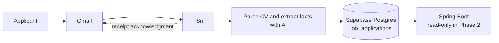

# RecruitFlow Phase 2 — Step-by-Step Guide

**Purpose:** Explain what Phase 2 means, what you will build, and what must be true before moving to Phase 3.

**Current status:** Phase 1 is complete. The n8n workflow receives CVs by Gmail, validates attachments, uses LlamaParse and OpenAI GPT-4.1 to extract applicant details, saves structured information to Supabase Postgres, and sends an acknowledgment email.

## Phase 2 in one sentence

Build the first Spring Boot backend and connect it safely to the **existing Supabase Postgres database**, so the backend can read current application records without interrupting the working n8n intake.

During Phase 2, n8n continues saving applications directly to Supabase. The backend does not take over the writes yet. That handoff is planned for Phase 4, after the API is built and secured.

## What you should have at the end

- A written description of the current `public.job_applications` table and what each field means.
- A decision for how applicants, applications, and jobs will relate in the future.
- A Spring Boot project in the `Backend` folder.
- A backend connection to the same Supabase Postgres project.
- A successful, limited, read-only database check from Spring Boot.
- A health endpoint and setup instructions.
- No changes to the live n8n intake logic or current database records.

## Before you start

You need access to the RecruitFlow repository, the Supabase project, and the n8n workflow. You will also need Java 17 or newer and a Java build tool such as Maven. Keep database passwords and tokens in a local environment file or secrets manager; do not put their values in this guide, Git, screenshots, or chat.

## Step 1 — Write down the current database contract

**What this means:** A data contract is a plain description of the information the current workflow saves. It helps the backend use the exact existing field names and prevents accidental renaming or data loss.

The current table is `public.job_applications`. Its fields include:

| Field | Meaning |
|---|---|
| `id` | Unique database ID for this saved application row. |
| `applicant_email` | Email address from the incoming message. |
| `applicant_name` | Name available from the email sender, when present. |
| `extracted_full_name` | Name the AI found in the CV, when present. |
| `gmail_message_id` | Gmail message identifier; unique and used to avoid duplicate application rows. |
| `gmail_thread_id` | Gmail conversation identifier. |
| `email_subject` | Subject of the application email. |
| `email_received_at` | Time the application email was received. |
| `resume_files` | JSON metadata about attachments, such as filename, type, and size. The actual file is still in Gmail. |
| `applicant_mobile_number` | Phone number extracted from the CV, when present. |
| `home_address` | Address extracted from the CV, when present. |
| `work_experience` | JSON list of work history extracted from the CV. |
| `status` | Recruitment status; new records currently start as `received`. |
| `extraction_status` | AI processing result: `pending`, `completed`, `needs_review`, or `failed`. |
| `extracted_at` | Time the extraction result was recorded. |
| `created_at` | Time the row was created in Postgres. |

**What to do:** Add a short data dictionary to the project documentation. For each field, record its type, whether it can be empty, its source (email, CV extraction, or database), and any uniqueness rule. Describe field meanings only; do not put real applicant values in the document.

**Expected result:** A developer can tell which name is from the email and which name is extracted from the CV, and can explain how duplicate emails are prevented.

## Step 2 — Decide how the future data model should work

**What this means:** The current table stores email, applicant, application, and attachment details together. The future HR system may want separate tables so one person can have more than one application and each application can be connected to a job.

Agree on these concepts:

- **Applicant:** A person and their contact/profile information.
- **Application:** One submission by an applicant for a particular job, with its own received date and recruitment status.
- **Job:** A position with a title, description, and requirements.
- **Resume:** File metadata and, later, a private storage reference to the original CV.

A likely future relationship is: one applicant can have many applications; one job can have many applications; each application belongs to one applicant and may be associated with one job. The current Phase 1 workflow does not reliably assign emails to a job yet, so document that as a later decision.

**What to do:** Draw or write this proposed relationship and map the existing `job_applications` fields to it. Record which information is missing or mixed together. Do not create all future tables just because they appear in the long-term plan.

**Expected result:** A reviewed model proposal and a list of any schema changes that are actually needed later. Keep the existing table and data as they are during Phase 2.

## Step 3 — Decide how the backend will access the database

**What this means:** The backend needs permission to read the data, but it should not connect as the database owner or get more access than it needs.

**What to do:**

1. Keep Supabase Postgres as the single source of truth. Do not create a MySQL copy.
2. Create or request a dedicated database role for the Spring Boot service. For Phase 2, it only needs the read permission required for the smoke check.
3. Confirm how Row Level Security (RLS) and database grants apply to this direct Postgres connection. The existing table has RLS enabled, but that does not replace authentication and authorization in the future HR API.
4. Choose a Supabase connection method appropriate for where Spring Boot will run. Use Supabase’s direct-connection and pooler guidance for the deployment environment.
5. Store the database URL, username, and password outside the source code. Commit only the variable names in an example environment file, never real values.

**Avoid:** Using the `postgres` owner login for normal application access, putting a secret/service-role key in frontend code, or making applicant data available from a public endpoint.

**Expected result:** The access method and permissions are documented, and the backend can connect with a separate, restricted account.

## Step 4 — Create the Spring Boot project

**What this means:** Spring Boot will be the server-side application between the future HR dashboard and Supabase. It will later provide APIs for reading applications and updating recruitment status.

**What to do:** Create a Spring Boot project under `Backend`. Start with:

- Spring Web, for health endpoints and later APIs.
- Spring Data JPA, to map and read Postgres data.
- PostgreSQL JDBC driver, to connect to Postgres.
- Bean Validation, to validate future API inputs.

Choose and record the Java and dependency versions. Commit the build file and lock down dependency versions as appropriate for the build tool.

**Expected result:** The project builds and starts locally, even before the HR API is implemented.

## Step 5 — Add safe database configuration

**What this means:** The app needs connection settings, but these must not be embedded in Java source or committed to Git.

**What to do:** Configure Spring’s datasource using environment variables. For example, document names such as `SPRING_DATASOURCE_URL`, `SPRING_DATASOURCE_USERNAME`, and `SPRING_DATASOURCE_PASSWORD` in `.env.example`, with blank or placeholder values only. Put actual credentials in a local ignored `.env` file or a secrets manager.

Configure JPA so the application validates or leaves the schema alone. Do not let Hibernate automatically create, rename, or update database tables. Phase 2 is not a schema migration phase.

**Expected result:** The backend can be configured on your computer or server without changing source code or exposing credentials.

## Step 6 — Map the existing table as read-only

**What this means:** Create only the Java mapping and repository needed to read the current application rows. This proves the backend can use real Phase 1 data before any API or workflow ownership changes.

**What to do:** Map the required columns from `public.job_applications` and create a repository with a small, limited read query. Keep the Phase 2 database account read-only. Do not add endpoints that return applicant data to the public internet.

**Expected result:** The backend can retrieve a limited set of existing application records in a local development run, and the n8n workflow remains the only intake writer.

## Step 7 — Add health checks and verify the connection

**What this means:** A health check tells you whether the backend is running. A database readiness check tells you whether it can reach Postgres.

**What to do:** Add a health endpoint that reports service health without revealing credentials, SQL, CV contents, or applicant details. Run the backend locally and verify that its database connection and read-only query succeed. Check application logs to make sure they do not print full CV text, addresses, phone numbers, passwords, or connection strings.

**Expected result:** You can start the service, see that it is healthy, and confirm the read path works without writing or changing any database data.

## Step 8 — Record the handoff to Phase 3

Write down:

- How to run the backend locally.
- The environment variable names it needs (not their values).
- The current table and the proposed applicant/application/job model.
- The database access role and connection method.
- What API operations Phase 3 should add.
- Any unresolved decision, especially how an incoming email will be linked to a job.

**Expected result:** Someone can continue with Phase 3 without guessing how Phase 1 data is stored or how to start the backend.

## Phase 2 completion checklist

- [ ] The current table and fields are documented without real applicant data.
- [ ] Applicant, application, and job concepts and their relationships are agreed.
- [ ] Supabase Postgres remains the only recruitment database.
- [ ] The Spring Boot project starts successfully.
- [ ] The backend connects using a dedicated, least-privilege database account.
- [ ] The backend can perform a limited read-only query against existing application rows.
- [ ] JPA does not create or change the database schema automatically.
- [ ] Health checks work and logs do not expose secrets or CV contents.
- [ ] The active n8n intake continues to save applications as before.
- [ ] Local setup and Phase 3 handoff decisions are documented.

## What Phase 2 does not include

Phase 2 does not build the full applicant/job/application API, HR login, dashboard, CV file storage, AI job matching, HR reminder automation, or a migration of n8n writes to Spring Boot. Those belong to later phases. In particular, n8n should not be changed to call Spring Boot until Phase 3 has a secured ingestion API and Phase 4 is ready to integrate it.

## Simple glossary

- **Data contract:** The documented field names, types, meanings, and rules used to exchange or store data.
- **Least privilege:** Give a service only the permissions needed for its current task.
- **JPA entity:** A Java class that represents a database table or view.
- **Repository:** The Java component that reads or writes data through JPA.
- **RLS:** Row Level Security, a Postgres feature that filters which rows a database/API role can access.
- **Migration:** A reviewed, versioned change to a database schema.
- **Connection pooler:** A service that manages reusable database connections for an application.

## Official references

- [Supabase: Connecting to Postgres](https://supabase.com/docs/guides/database/connecting-to-postgres)
- [Supabase: Postgres roles](https://supabase.com/docs/guides/database/postgres/roles)
- [Supabase: Securing your data](https://supabase.com/docs/guides/database/secure-data)
- [Supabase: Row Level Security](https://supabase.com/docs/guides/database/postgres/row-level-security)
- [Spring Initializr](https://start.spring.io/)