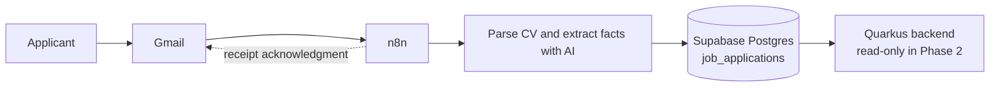

# RecruitFlow Phase 2 — Quarkus Backend Foundation Guide

**Purpose:** Explain what Phase 2 means, what to build, and what must be true before Phase 3.

**Current status (2026-11-10):** Phase 1 is complete. The `Backend` folder now contains a generated Quarkus Maven project using Java 25 and Quarkus platform 3.40.1.2. The Supabase datasource, read-only data mapping/query, and database role/policy are not yet configured or verified. The generated starter still needs cleanup before it is connected to the existing database.

## Phase 2 in one sentence

Prepare a Quarkus backend that can safely read the existing Supabase Postgres applications table while n8n continues to own applicant intake and writes.



During Phase 2, n8n remains the only intake writer. The backend must not create or alter the live schema. Routing n8n through a secured backend API is planned for Phase 4, after the Phase 3 API has been designed, secured, and verified.

## What you should have at the end

- A written description of the current `public.job_applications` data contract.
- A reviewed proposal for how applicants, applications, and jobs will relate in the future.
- A clean Quarkus project in `Backend`, retaining its Java 25 and Quarkus 3.40.1.2 Maven setup.
- A dedicated, least-privilege Supabase database role with an appropriate RLS policy.
- A Quarkus read-only connection and count/read smoke check against the existing table.
- A working Quarkus health endpoint and clear local run instructions.
- No disruption to the Phase 1 n8n workflow or existing Supabase records.

## Before starting

You need access to the project repository, Supabase, and n8n. Java 25 and the Maven Wrapper are already part of the current setup. Quarkus CLI is optional; use `Backend/mvnw.cmd` from PowerShell. Keep database passwords in local environment variables or a secrets manager, never in Git or this guide.

## Step 1 — Document the current database contract

**What this means:** Record the existing fields and rules so Quarkus maps the live table accurately and does not accidentally rename or recreate it.

The current table is `public.job_applications`. Its fields include:

| Field | Meaning |
|---|---|
| `id` | Unique database ID for an application row. |
| `applicant_email` | Email address from the incoming message. |
| `applicant_name` | Sender name from the email, when available. |
| `extracted_full_name` | Name the AI found in the CV, when available. |
| `gmail_message_id` | Unique Gmail message ID used to prevent duplicate rows. |
| `gmail_thread_id` | Gmail conversation identifier. |
| `email_subject` | Subject of the application email. |
| `email_received_at` | Time the email was received. |
| `resume_files` | JSON attachment metadata; the original CV remains in Gmail. |
| `applicant_mobile_number` | Phone number extracted from the CV, when available. |
| `home_address` | Address extracted from the CV, when available. |
| `work_experience` | JSON work history extracted from the CV. |
| `status` | Recruitment status; new rows currently start as `received`. |
| `extraction_status` | AI processing state: `pending`, `completed`, `needs_review`, or `failed`. |
| `extracted_at` | Time the extraction result was recorded. |
| `created_at` | Time the row was created in Postgres. |

**Do:** Use `Docs/Phase_2_Data_Contract.md` as the data dictionary. Describe field meanings and types; do not add real applicant values.

**Expected result:** A developer can distinguish email-supplied values from CV-extracted values and explain duplicate protection.

## Step 2 — Decide the future recruitment data model

The current table combines email, applicant, application, and attachment information. The future system may separate these concepts:

- **Applicant:** Person and contact/profile information.
- **Application:** One submission by an applicant, with its own received time and recruitment status.
- **Job:** Position title, description, and requirements.
- **Resume:** File metadata and a private reference to the original CV.

A likely model allows one applicant to have multiple applications, one job to have multiple applications, and each application to belong to one applicant and optionally one job. Since Phase 1 does not reliably assign every email to a job, record that as an unresolved business decision.

**Do:** Document the proposed relationships and map existing fields to them. Do not create future tables in this phase. Keep `public.job_applications` and its records unchanged.

## Step 3 — Set a least-privilege Supabase access model

1. Keep Supabase Postgres as the single source of truth; do not make a MySQL copy.
2. Provision a dedicated database login for the Quarkus backend. It should not own the database and must not have `BYPASSRLS`.
3. Grant only the access needed for the Phase 2 read check. The current table has RLS enabled and no policies, so a SELECT grant alone is not sufficient; prepare and review the role-scoped policy SQL inside `Backend/database/`; do not run it against Supabase until the role and requested change have been reviewed.
4. Use a supported Supabase direct connection or Session Pooler for the service's deployment environment. For a Hibernate/JPA datasource, avoid the transaction pooler.
5. Use SSL. Put the URL, username, and password in local environment variables or a secrets manager.

**Never:** Use the database owner or a `service_role`/secret API key as the routine datasource credential, commit credentials, or expose applicant records publicly.

## Step 4 — Clean and confirm the Quarkus Maven project

The `Backend` folder already has the Quarkus Maven project. Preserve the Java 25 compiler setting, Quarkus BOM, and Quarkus Maven plugin unless a later decision explicitly changes them.

For this Java REST/JPA/Postgres backend, the intended runtime capabilities are:

- `quarkus-rest-jackson` — REST resources with JSON support.
- `quarkus-hibernate-orm-panache` — Hibernate ORM using the repository pattern.
- `quarkus-jdbc-postgresql` — PostgreSQL JDBC datasource.
- `quarkus-smallrye-health` — liveness/readiness health endpoints.

Use the Quarkus BOM to manage extension versions. Keep test dependencies such as `quarkus-junit` and `rest-assured` in test scope. Avoid duplicate selections (for example REST plus REST Jackson, ORM plus Panache) and remove Kotlin-specific Panache from this Java project unless Kotlin is deliberately adopted.

Remove generated sample artifacts such as `GreetingResource`, `MyEntity`, and unrelated sample SQL before connecting this project to Supabase. Keep the package structure understandable:

```text
model/       JPA/domain models
repository/  database queries
service/     use cases and transaction boundaries
resource/    Quarkus REST endpoints (controller equivalent)
dto/         request and response contracts
config/      runtime configuration and health checks
```

Phase 2 does not expose applicant REST resources. The `resource/` and `dto/` packages can remain empty until a secured API is designed.

**Expected result:** The generated demo is replaced by a clean Quarkus foundation, with only the Java extensions this backend needs.

## Step 5 — Configure the datasource safely

Configure `application.properties` to read datasource details from the process environment. Use the Quarkus datasource property names:

- `QUARKUS_DATASOURCE_JDBC_URL`
- `QUARKUS_DATASOURCE_USERNAME`
- `QUARKUS_DATASOURCE_PASSWORD`

For a local PowerShell session, set the values without saving secrets to a tracked file:

```powershell
$env:QUARKUS_DATASOURCE_JDBC_URL = 'jdbc:postgresql://YOUR_SESSION_POOLER_HOST:5432/postgres?sslmode=require'
$env:QUARKUS_DATASOURCE_USERNAME = 'recruitflow_backend_readonly'
$env:QUARKUS_DATASOURCE_PASSWORD = 'YOUR_LOCAL_ROLE_PASSWORD'
```

Use the actual connection string from Supabase. For stronger server identity verification, download the current Supabase database CA certificate and configure `sslmode=verify-full` with its local path.

Before connecting to the real Supabase database, configure Hibernate ORM to make no schema changes and disable SQL seed scripts. In particular, use `quarkus.hibernate-orm.schema-management.strategy=none` and disable data/import scripts. Do not use `drop-and-create`, `create`, or `update` against the Supabase project. The generated `import.sql` is currently only a commented demo. Remove it or explicitly disable it before connecting to Supabase; it must never seed or change the production database.

**Expected result:** Quarkus connects only with local secrets and will not create, update, drop, or seed the Supabase schema.

## Step 6 — Add the read-only model, repository, and service

1. Map only the required fields of `public.job_applications` in a read-only JPA model.
2. Keep the repository narrow: a count or limited, paginated query only. Do not add write methods in Phase 2.
3. Put query use cases in a service and mark read transactions read-only.
4. Do not return entities or applicant PII from a public REST resource. Phase 2 has no applicant API.
5. Keep n8n as the only intake writer until Phase 4.

**Expected result:** A local Quarkus run can execute a limited read query using the restricted database role, without writing or exposing applicant data.

## Step 7 — Add health checks and verify the read path

Use SmallRye Health endpoints such as `/q/health/live` and `/q/health/ready`. Liveness confirms the process is running; readiness should report whether the service is ready for work. Do not include passwords, connection strings, CV text, or applicant fields in health responses or logs.

Run the Maven Wrapper from `Backend`:

```powershell
.\mvnw.cmd quarkus:dev
```

Check health in a browser or PowerShell at `http://localhost:8080/q/health`. Enable a minimal read check only after the database role, RLS policy, URL, and SSL settings are ready. Confirm that it reads a count or a small result and never logs applicant details.

**Expected result:** The app starts, health is visible, and a read-only database check succeeds without schema or data changes.

## Step 8 — Prepare the Phase 3 handoff

Record the local run steps, Quarkus version, extension list, environment variable names, current table mapping, access role/policy, and agreed applicant/application/job relationships. List the endpoints Phase 3 will add and identify authentication and authorization requirements before exposing applicant data.

## Phase 2 completion checklist

- [x] Phase 1 data contract documented in `Docs/Phase_2_Data_Contract.md`.
- [x] Quarkus Maven project scaffold exists in `Backend` with Java 25 and Quarkus 3.40.1.2.
- [ ] Generated starter code and redundant/non-Java extensions are cleaned up.
- [ ] Applicant, application, and job relationships are reviewed and agreed.
- [ ] A dedicated least-privilege role and role-scoped RLS SELECT policy are provisioned.
- [ ] Quarkus datasource configuration uses environment variables and SSL.
- [ ] Hibernate schema generation and seed scripts are explicitly disabled for Supabase.
- [ ] Read-only model, repository, and service query the existing table.
- [ ] Quarkus starts and health endpoints work.
- [ ] A limited read-only query succeeds against Supabase.
- [ ] Phase 1 n8n intake continues unchanged as the only writer.
- [ ] Local setup and the Phase 3 handoff are documented.

## What Phase 2 does not include

Phase 2 does not build applicant/job/application CRUD APIs, HR login, a dashboard, CV file storage, AI job matching, HR reminders, or the n8n-to-backend write handoff. Those belong to later phases. Do not route n8n through Quarkus until the Phase 3 API is authenticated and Phase 4 integration is ready.

## Simple glossary

- **Data contract:** Documented field names, types, meanings, and storage rules.
- **Least privilege:** Give a service only the permissions required for its current task.
- **JPA entity:** A Java class mapped to a database table or view.
- **Repository:** The persistence component that executes database queries.
- **REST resource:** A Quarkus HTTP endpoint class; it serves the role commonly called a controller in Spring applications.
- **RLS:** Row Level Security, which restricts which rows a Postgres role can access.
- **Migration:** A reviewed, versioned database schema change.
- **Connection pooler:** A service that manages reusable database connections.

## Official references

- [Quarkus Maven tooling](https://quarkus.io/guides/maven-tooling)
- [Quarkus REST](https://quarkus.io/guides/rest)
- [Quarkus Hibernate ORM with Panache](https://quarkus.io/guides/hibernate-orm-panache)
- [Quarkus Hibernate ORM schema management](https://quarkus.io/guides/hibernate-orm)
- [Quarkus SmallRye Health](https://quarkus.io/guides/smallrye-health)
- [Supabase: Connecting to Postgres](https://supabase.com/docs/guides/database/connecting-to-postgres)
- [Supabase: Postgres roles](https://supabase.com/docs/guides/database/postgres/roles)
- [Supabase: Securing your data](https://supabase.com/docs/guides/database/secure-data)
- [Supabase: Row Level Security](https://supabase.com/docs/guides/database/postgres/row-level-security)

