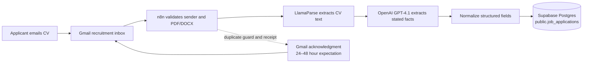

# RecruitFlow --- Development Execution Plan

> **Purpose:** This is the working development checklist for building
> RecruitFlow phase by phase. Complete the tasks and acceptance criteria
> in each phase before moving to the next one.
>
> **Recommended approach:** Phase 1 now handles applicant email intake,
> CV validation, AI extraction, Supabase persistence, and receipt
> acknowledgments. Next, build the backend foundation around that existing
> Supabase database, add secure recruitment APIs, then route n8n through
> the backend before building the HR dashboard.

------------------------------------------------------------------------

## Project goal

Build a single-company HR Recruitment Management System that:

-   Receives applicant CVs through a Gmail inbox.
-   Automatically acknowledges valid applications.
-   Extracts CV text from PDF and DOCX files.
-   Stores applicant and application information.
-   Assists HR with job-specific CV assessments.
-   Lets HR review candidates and manage recruitment statuses.
-   Reminds HR when applications have not been reviewed or contacted.

**Important:** AI assists HR. It must not make final hiring or rejection
decisions.

## Current architecture after Phase 1



Phase 1's current n8n workflow writes directly to Supabase Postgres. The
planned architecture keeps that database as the single source of truth.
In Phase 4, after the backend API is secure and ready, n8n will send
application data through Spring Boot, which will write to the same
Supabase database. The frontend will use the authenticated backend API;
it will not connect with database passwords or privileged keys.

## Technology stack

  Area                  Technology
  --------------------- ----------------------------------------------------
  Workflow automation   n8n Cloud (current Phase 1 instance)
  Email                 Gmail API / Gmail OAuth
  Backend               Java 17+ / Spring Boot
  Database              Supabase Postgres (single source of truth)
  Frontend              Next.js / TypeScript / Tailwind CSS
  CV parsing            LlamaParse (current); evaluate Tika only if needed
  AI                    OpenAI GPT-4.1 for Phase 1 extraction; job assessment later
  API testing           Postman
  Source control        Git / GitHub
  Local environment     Docker / Docker Compose

------------------------------------------------------------------------

# Phase 0 --- Project preparation

**Goal:** Prepare the development environment and repository.

### Tasks

-   [ ] Create a GitHub repository named `recruitflow`.
-   [ ] Create the initial folder structure.
-   [ ] Install/check Java 17 or newer.
-   [ ] Install/check Node.js and npm.
-   [ ] Confirm Supabase Postgres project access and database configuration.
-   [ ] Install Docker Desktop.
-   [ ] Decide whether to run n8n with Docker or npm.
-   [ ] Create a project `.gitignore`.
-   [ ] Create a local environment configuration file (do not commit
    secrets).
-   [ ] Add a basic README with setup instructions.

### Suggested structure

``` text
recruitflow/
├── frontend/
├── backend/
├── automation/
│   └── n8n-workflows/
├── database/
│   └── migrations/
├── docs/
│   ├── architecture/
│   └── development/
├── docker-compose.yml
├── .gitignore
└── README.md
```

### Acceptance criteria

-   [ ] Repository exists and initial commit is pushed.
-   [ ] Required development tools are installed.
-   [ ] Folder structure is committed.
-   [ ] Secrets and local environment files are excluded from Git.

------------------------------------------------------------------------

# Phase 1 --- Gmail + n8n + Supabase applicant intake

**Status: Complete — owner confirmed the end-to-end intake, acknowledgment, Supabase save, and AI extraction are working (2026-11-10).**

**Phase 1 goal:** An applicant emails a CV to the recruitment Gmail inbox. n8n validates the message and CV, extracts available applicant details with AI, saves the application record to Supabase Postgres, and sends an automated receipt confirmation with a 24–48-hour contact expectation. The records are ready for HR review in a later phase; a dashboard and HR status management are not part of Phase 1.

This is the implemented Phase 1 scope, expanded from the original Gmail-only proof of concept. The current workflow is the n8n Cloud workflow **HR Recruitment Automation - WF**.

## Implemented workflow

1. Gmail Trigger detects messages sent to the recruitment inbox.
2. n8n fetches the full message and its attachment, then checks for a sender and an allowed PDF or DOCX CV (up to 10 MB).
3. LlamaParse reads the CV and the OpenAI node returns structured fields when they can be found, including applicant name, mobile number, address, and work experience.
4. A parameterized Postgres query writes or updates the application in Supabase table public.job_applications, using the Gmail message ID to avoid duplicate application rows.
5. A Gmail acknowledgment is configured with the subject **Application Received | People Serve MPC** and tells the applicant the team aims to contact them within 24–48 hours.

## Workflow implementation notes

- [x] Gmail Trigger has received multiple applicant messages in one execution.
- [x] The workflow kept the applicants and their CV attachments paired in execution 111.
- [x] CV extraction ran for both applicants in that execution.
- [x] Both application records were saved to Supabase.
- [x] The Merge node is configured to combine by position.
- [x] The acknowledgment routing fix is published: the Data Table lookup sets explicit ack_exists and should_acknowledge flags before the Merge, so Normalize can carry them through to Postgres.
- [x] The workflow canvas includes a published Phase 1 summary note covering intake, AI extraction, Supabase persistence, and acknowledgments.

## Completion record

- [x] Owner confirms applicants email a CV, receive an automatic acknowledgment with a 24–48-hour contact expectation, and application information is saved in Supabase Postgres.
- [x] Owner confirms the AI workflow extracts applicant information and experience.
- [x] Phase 1 marked complete on 2026-11-10 based on the owner's end-to-end completion report.

**Evidence note:** The prior execution notes in this document recorded that execution 111 predated the latest acknowledgment-routing change and did not run the Gmail send node. The owner has since confirmed Phase 1 is working. Keep this historical note as context; no new execution or mailbox evidence was provided in this update.

## Data and scope notes

- Supabase Postgres is the current Phase 1 database. The initial table is public.job_applications.
- resume_files currently stores attachment metadata (such as filename, MIME type, and size), not the actual PDF/DOCX file. The original CV remains in Gmail; Supabase Storage has not been connected for CV file storage.
- The automated acknowledgment is a receipt confirmation. It does not perform the HR team's actual 24–48-hour follow-up.
- AI extraction is assistive and may require manual review. It does not decide whether to hire or reject an applicant.
- The Spring Boot backend, HR dashboard, job-specific assessment, applicant status management, and scheduled HR reminders remain later-phase work.
- The original Gmail-only POC guide is historical setup material; this section describes the current integrated workflow.

**Phase 1 deliverable:** The working n8n workflow that receives applicant CVs, stores application information in Supabase, and sends an acknowledgment email.

------------------------------------------------------------------------
# Phase 2 --- Supabase data model and Spring Boot foundation

**Goal:** Prepare a secure backend foundation that can read the data
created in Phase 1. Keep Supabase Postgres as the single source of truth.
Do not create a parallel MySQL database, copy applicant records, or move
the live n8n writes yet.

### Phase 2 step-by-step

1. **Document the current Phase 1 data contract.** Record the columns,
   unique Gmail message ID, status and extraction status values, JSON
   fields for work experience and attachment metadata, and which values
   come from the email versus the CV. Do not copy real applicant data into
   documentation.
2. **Agree on the target recruitment model.** Decide how a person maps to
   an applicant, how each email maps to an application, and how an
   application will eventually link to a job. Keep `public.job_applications`
   intact for this phase; identify any future normalization as a reviewed
   migration, not a rewrite of the working intake table.
3. **Choose and document the access model.** The Spring Boot service runs
   on a trusted server and connects to Supabase Postgres using a dedicated
   least-privilege database role and secret environment variables. Do not
   put a database password, Supabase secret/service-role key, or other
   privileged credential in frontend code or Git. Confirm RLS and grants
   for any table exposed through Supabase APIs.
4. **Create the Spring Boot project.** Add Spring Web, Spring Data JPA,
   PostgreSQL JDBC, and Bean Validation. Record the Java and dependency
   versions. Keep database schema generation in validate/no-change mode;
   create migrations only for agreed schema changes.
5. **Connect to the existing Supabase Postgres project.** Use the
   connection method and pooler mode appropriate for the deployed Spring
   Boot runtime. Load connection values from local environment variables
   or a secrets manager. Never use the database owner credentials as the
   application's routine account.
6. **Map the existing table without changing it.** Create the minimum
   entity/repository mapping needed to read existing applications. Keep
   this access read-only during Phase 2 so n8n remains the only intake
   writer until Phase 4.
7. **Add health checks and a database read smoke check.** Confirm the
   service starts, reports its own health, and can read a small,
   paginated set of application records without logging CV contents or
   unnecessary personal data.
8. **Document the Phase 3 handoff.** Record the backend run steps,
   environment variable names (never values), schema decisions, and the
   API operations Phase 3 will add.

### Phase 2 scope decisions

- The existing `public.job_applications` table is the Phase 2 starting
  point; do not create all future tables just to complete the foundation.
- The eventual model may include `applicants`, `jobs`, `applications`,
  `resumes`, `assessments`, `interviews`, `email_logs`, and audit or
  automation logs. Add each table only when its owning phase needs it.
- HR authentication and authorization must be decided before exposing
  applicant data through a network API or dashboard. Never expose
  applicant records publicly.
- Supabase Auth can be evaluated for HR sign-in in the dashboard phase;
  do not create a custom password table.
- Original CV files are still in Gmail. Private Supabase Storage and a
  database storage reference are later work, before the dashboard offers
  CV viewing or downloading.

### Phase 2 tasks

- [ ] Document the current `public.job_applications` schema and field
      mapping, without real candidate values.
- [ ] Approve the target applicant/application/job relationship and list
      any schema changes needed later.
- [ ] Record database role, RLS, API exposure, and credential handling
      decisions.
- [ ] Create the Spring Boot project and pin dependencies.
- [ ] Configure the PostgreSQL driver and environment-based connection.
- [ ] Map the existing table read-only; keep Hibernate schema changes
      disabled.
- [ ] Add health and readiness checks.
- [ ] Verify a read-only query against existing application rows.
- [ ] Document local startup and deployment configuration.

### Acceptance criteria

- [ ] Spring Boot starts without changing the Supabase schema.
- [ ] The backend can connect to the existing Supabase Postgres project
      using a dedicated, least-privilege account.
- [ ] A read-only repository query can retrieve application records.
- [ ] No public route exposes applicant data before authentication and
      authorization are in place.
- [ ] No CV text, private applicant data, or credentials are written to
      logs or committed to Git.
- [ ] Phase 1's active n8n intake continues to save applications exactly
      as before.

**Phase 2 deliverable:** A documented data contract and a running Spring Boot foundation that securely reads existing Supabase Postgres applications without interrupting Phase 1 intake.

Supabase references: [Connecting to Postgres](https://supabase.com/docs/guides/database/connecting-to-postgres), [Postgres roles](https://supabase.com/docs/guides/database/postgres/roles), and [Securing your data](https://supabase.com/docs/guides/database/secure-data).

------------------------------------------------------------------------
# Phase 3 --- Core backend REST APIs

**Goal:** Implement recruitment business operations before connecting
the full automation.

### Applicant APIs

-   [ ] `GET /api/v1/applicants`
-   [ ] `GET /api/v1/applicants/{id}`
-   [ ] `POST /api/v1/applicants`
-   [ ] `PUT /api/v1/applicants/{id}`

### Job APIs

-   [ ] `GET /api/v1/jobs`
-   [ ] `GET /api/v1/jobs/{id}`
-   [ ] `POST /api/v1/jobs`
-   [ ] `PUT /api/v1/jobs/{id}`
-   [ ] `PATCH /api/v1/jobs/{id}/status`

### Application APIs

-   [ ] `GET /api/v1/applications`
-   [ ] `GET /api/v1/applications/{id}`
-   [ ] `POST /api/v1/applications`
-   [ ] `PATCH /api/v1/applications/{id}/status`

### Integration APIs

-   [ ] `POST /api/v1/integrations/applications/email`
-   [ ] `POST /api/v1/integrations/applications/{id}/processing-status`
-   [ ] `GET /api/v1/integrations/applications/pending-follow-up`

### General backend tasks

-   [ ] Create request and response DTOs.
-   [ ] Implement service classes.
-   [ ] Implement controllers.
-   [ ] Add request validation.
-   [ ] Add centralized exception handling.
-   [ ] Add pagination and filtering.
-   [ ] Add service and controller tests.
-   [ ] Test APIs using Postman.
-   [ ] Protect integration endpoints with service authentication.

### Acceptance criteria

-   [ ] Applicant records can be created, retrieved, and updated.
-   [ ] Jobs can be created, retrieved, and updated.
-   [ ] Applications can be created and assigned to a job.
-   [ ] Recruitment status can be updated.
-   [ ] Invalid requests return understandable errors.
-   [ ] Integration endpoints are not publicly accessible without
    authentication.

**Phase 3 deliverable:** Tested recruitment REST API.

------------------------------------------------------------------------

# Phase 4 --- Route n8n intake through Spring Boot

**Goal:** Replace the direct n8n-to-Postgres write with the secured Spring Boot ingestion API, while keeping Gmail intake, CV parsing/extraction, and acknowledgments in n8n. Do this only after the Phase 3 API is authenticated and tested.

### Tasks

-   [ ] Define the JSON payload exchanged between n8n and Spring Boot.
-   [ ] Define how an email is matched to a job (job reference, email
    subject convention, or HR review).
-   [ ] Define a private file-storage location.
-   [ ] Store the original CV securely.
-   [ ] Pass file metadata and storage reference to Spring Boot.
-   [ ] Extract candidate information when possible.
-   [ ] Call the authenticated application-ingestion endpoint.
-   [ ] Save the applicant, resume, and application records.
-   [ ] Use Gmail message ID and attachment identifiers for idempotency.
-   [ ] Log workflow execution status.
-   [ ] Add retry and manual-review paths.

### Acceptance criteria

-   [ ] A valid test email creates an application through Spring Boot in Supabase Postgres.
-   [ ] The original CV is stored privately.
-   [ ] The database stores a storage reference, not a public CV URL.
-   [ ] Reprocessing the same email does not create a duplicate
    application.
-   [ ] Failed processing is visible and recoverable.

**Phase 4 deliverable:** Gmail → n8n → authenticated Spring Boot API → Supabase Postgres, with duplicate protection and recoverable failures.

------------------------------------------------------------------------

# Phase 5 --- HR Dashboard

**Goal:** Allow HR to review and manage the records created by the
backend.

### Tasks

-   [ ] Initialize Next.js with TypeScript.
-   [ ] Configure Tailwind CSS.
-   [ ] Create shared layout and navigation.
-   [ ] Create login page.
-   [ ] Connect authentication to Spring Boot.
-   [ ] Create dashboard overview.
-   [ ] Create applicants list.
-   [ ] Add search, filters, and pagination.
-   [ ] Create applicant detail page.
-   [ ] Display application and resume information.
-   [ ] Add authorized CV viewing/downloading.
-   [ ] Create job management pages.
-   [ ] Create application status controls.
-   [ ] Create recruitment pipeline view.
-   [ ] Add loading, empty, success, and error states.

### Acceptance criteria

-   [ ] HR can log in.
-   [ ] HR can view applicants received through Gmail.
-   [ ] HR can view applicant and application details.
-   [ ] HR can access CVs only when authorized.
-   [ ] HR can update application status.
-   [ ] Dashboard data comes from Spring Boot APIs, not hardcoded sample
    arrays.

**Phase 5 deliverable:** Working HR dashboard connected to the backend.

------------------------------------------------------------------------

# Phase 6 --- Extraction quality and evidence-based AI assessment

**Goal:** Build on Phase 1 extraction: improve parsing reliability and
compare extracted CV evidence with job-specific criteria to assist HR.
Do not repeat the basic intake and extraction work already completed in
Phase 1.

### Extraction quality tasks

- [x] Phase 1 parses supported PDF/DOCX CVs and extracts basic applicant
      details and work experience with LlamaParse and OpenAI GPT-4.1.
- [ ] Review extraction quality on representative, consented test CVs.
- [ ] Decide whether to keep LlamaParse alone or add Apache Tika as a
      fallback; do not add a second parser without a clear need.
- [ ] Handle empty, malformed, encrypted, and unsupported documents.
- [ ] Store extraction status and relevant metadata.
- [ ] Avoid logging full CV contents unnecessarily.

### AI assessment tasks

- [ ] Define job-specific required and preferred criteria.
- [ ] Ask the AI to return evidence snippets for each criterion.
- [ ] Distinguish `evidenced`, `not_found`, and `unclear`.
- [ ] Validate AI output in Spring Boot.
- [ ] Save assessment result and model/criteria version.
- [ ] Display assessment and supporting evidence in the dashboard.
- [ ] Provide manual review when extraction or assessment fails.

### Example job criteria

**Java Backend Developer**

Required: - Java - Spring Boot - REST API development - SQL / relational
databases - Object-oriented programming

Preferred: - Microservices - Docker - AWS - CI/CD

### Acceptance criteria

- [ ] Supported CVs parse reliably, with extraction failures visible.
- [ ] Assessment is based on the selected job's criteria.
- [ ] Findings include evidence from the CV where available.
- [ ] Missing information is not treated as proof that a candidate
      lacks a skill.
- [ ] AI does not automatically reject candidates.
- [ ] HR can review the original CV and assessment.

**Phase 6 deliverable:** Reliable extraction and evidence-based,
human-reviewed, job-specific AI assistance.

------------------------------------------------------------------------
# Phase 7 --- HR reminders and recruitment workflow

**Goal:** Remind HR about applications that need attention.

### Tasks

-   [ ] Record application received timestamp.
-   [ ] Decide whether the SLA uses calendar hours or business hours.
-   [ ] Set the correct timezone.
-   [ ] Create a scheduled n8n workflow.
-   [ ] Retrieve applications pending HR action.
-   [ ] Send a reminder after 24 hours when eligible.
-   [ ] Escalate after 48 hours when still eligible.
-   [ ] Stop reminders when HR records contact/review.
-   [ ] Log reminder history.
-   [ ] Test weekends, retries, and status changes.

### Acceptance criteria

-   [ ] Eligible applications receive reminders at the configured
    intervals.
-   [ ] Applications already acted upon do not receive unnecessary
    reminders.
-   [ ] Reminder attempts and outcomes are logged.
-   [ ] The workflow handles failures without silently skipping
    applications.

**Phase 7 deliverable:** Automated HR follow-up workflow.

------------------------------------------------------------------------

# Phase 8 --- Testing, security, and deployment

**Goal:** Prepare a reliable portfolio-ready application.

### Testing

-   [ ] Unit-test backend services.
-   [ ] Integration-test database operations.
-   [ ] Test API validation and authorization.
-   [ ] Test Gmail trigger and email sending.
-   [ ] Test PDF and DOCX extraction.
-   [ ] Test AI response validation.
-   [ ] Test duplicate email processing.
-   [ ] Test workflow retry and failure handling.
-   [ ] Test the complete applicant-to-HR journey.

### Security and privacy

-   [ ] Keep credentials in environment variables or a secrets manager.
-   [ ] Use OAuth for Gmail.
-   [ ] Secure HR authentication and authorization.
-   [ ] Secure n8n-to-backend communication.
-   [ ] Keep CV files private.
-   [ ] Validate actual file content and size.
-   [ ] Consider malware scanning before production.
-   [ ] Avoid storing unnecessary personal information.
-   [ ] Define retention and deletion policies for applicant records.
-   [ ] Treat CV text as untrusted AI input.
-   [ ] Keep human review responsible for hiring decisions.
-   [ ] Back up database and file storage.

### Deployment

-   [ ] Create Dockerfiles where appropriate.
-   [ ] Configure Docker Compose for local services.
-   [ ] Document production environment variables.
-   [ ] Choose hosting for frontend, backend, database, n8n, and file
    storage.
-   [ ] Configure HTTPS.
-   [ ] Configure database and file backups.
-   [ ] Add application and workflow monitoring.
-   [ ] Write deployment and recovery instructions.

### Acceptance criteria

-   [ ] Main end-to-end workflow passes tests.
-   [ ] Failures are logged and can be investigated.
-   [ ] Secrets are not included in the repository.
-   [ ] CV files are not publicly exposed.
-   [ ] Deployment and setup instructions are documented.

**Phase 8 deliverable:** Tested and documented RecruitFlow release.

------------------------------------------------------------------------

# Recommended development order at a glance

| Phase | Focus | Main result |
|---|---|---|
| 0 | Project preparation | Repository and development environment ready |
| 1 | Gmail + n8n + AI + Supabase intake | CV validation, AI extraction, database save, applicant acknowledgment (complete) |
| 2 | Data contract + Spring Boot foundation | Backend securely reads existing Supabase applications |
| 3 | Core REST APIs | Authenticated applicant, job, and application operations |
| 4 | n8n + backend integration | n8n sends application data through Spring Boot into the same Supabase database |
| 5 | HR dashboard | HR can review candidates and manage statuses |
| 6 | Extraction quality + AI assessment | Job-specific findings with evidence and human review |
| 7 | HR reminders | Follow-up reminders for applications needing action |
| 8 | Testing, security, deployment | Reliable documented release |

------------------------------------------------------------------------
# Definition of Done --- Every Phase

Before marking a phase complete:

-   [ ] All tasks for the phase are completed or explicitly deferred.
-   [ ] Acceptance criteria have been tested.
-   [ ] No credentials or private applicant data are committed to Git.
-   [ ] Important decisions and setup steps are documented.
-   [ ] Code and workflow changes are committed to Git.
-   [ ] The next phase can use the current phase's deliverables without
    relying on unfinished features.

## First task to begin

Begin Phase 2 by documenting the existing `public.job_applications`
columns and deciding the applicant/application/job relationship. Then
create the Spring Boot foundation with a least-privilege, read-only
connection to the existing Supabase Postgres database. Leave the current
n8n workflow as the intake writer until the secured ingestion API is
ready in Phase 4.